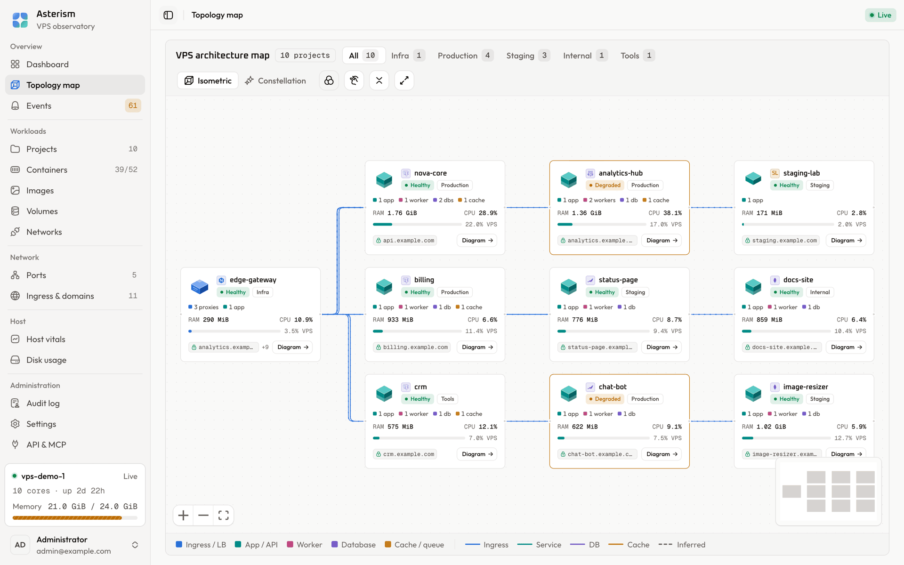
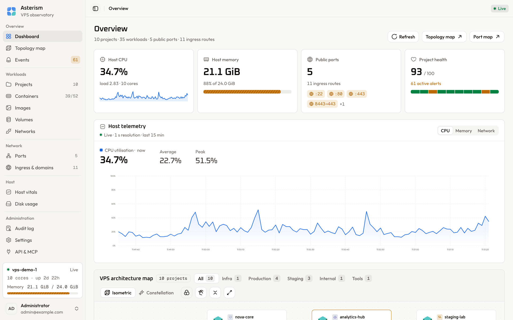
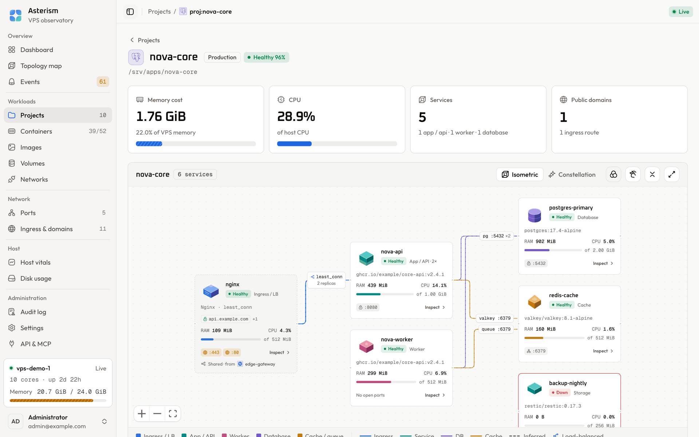
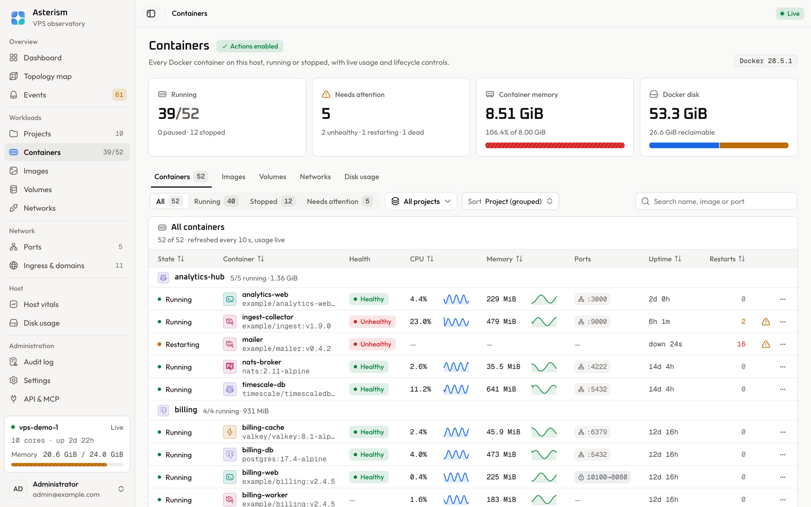
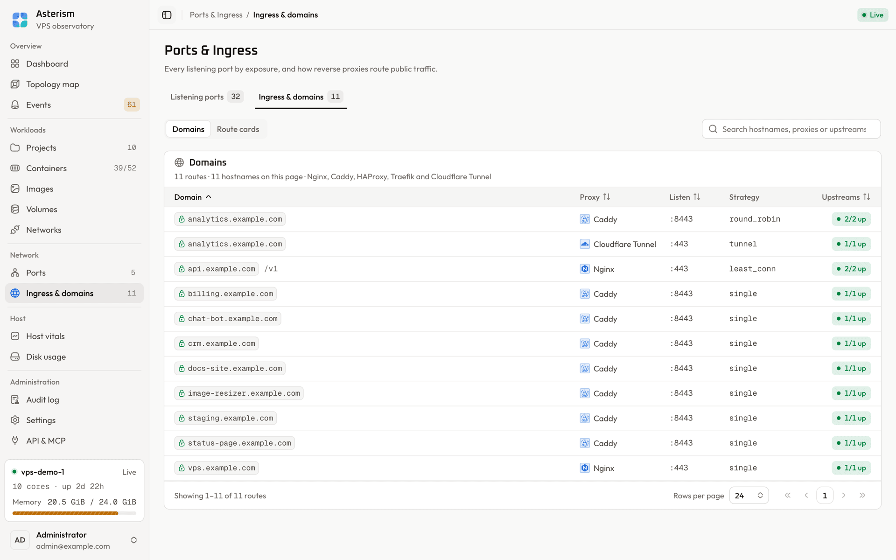
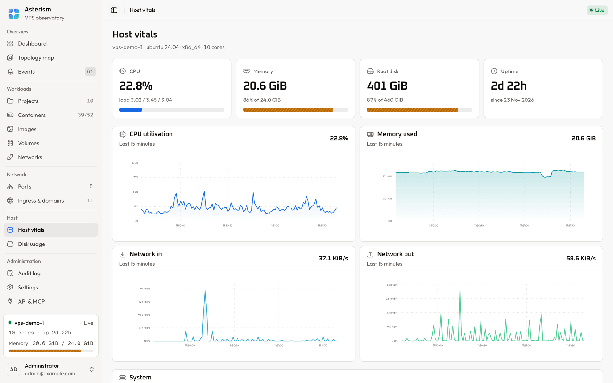
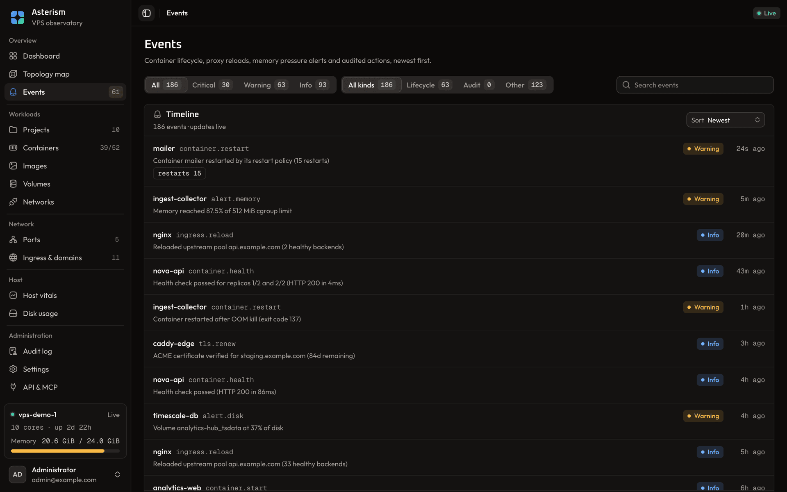
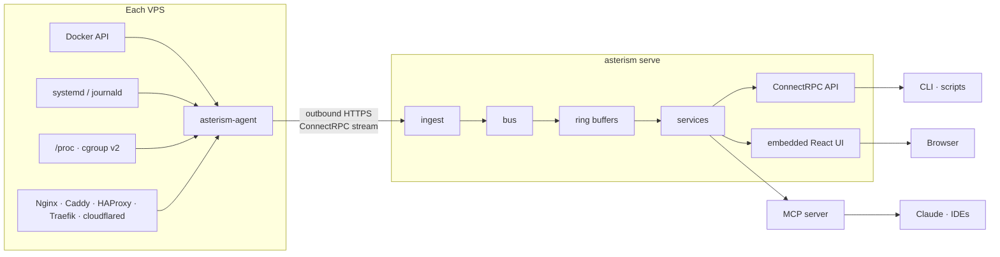

<p align="center">
  <picture>
    <source media="(prefers-color-scheme: dark)" srcset="docs/brand/logo-dark.svg">
    
  </picture>
</p>

<p align="center">
  <strong>A self-hosted observatory for the VPS you actually run.</strong><br>
  One Go binary with an embedded web UI that maps projects, containers, open ports,<br>
  reverse-proxy routes and live resource cost, read-only by default.
</p>

<p align="center">
  <a href="https://github.com/prabhavalabs/asterism/actions/workflows/ci.yml"></a>
  <a href="LICENSE"></a>
  
</p>

<p align="center">
  <picture>
    <source media="(prefers-color-scheme: dark)" srcset="docs/screenshots/topology-dark.png">
    
  </picture>
</p>

> Screenshots in this README come from the built-in `showcase` mode: every project, domain and
> image is fictional, and no real server data is shown.

## Why Asterism

A small VPS tends to grow into a dozen compose projects, a shared Postgres, a reverse proxy,
a Cloudflare Tunnel and a few systemd units. `docker ps` shows a flat list of containers;
Asterism shows the **system**: which project each container belongs to, what it costs in
memory and CPU, which ports are really public, and how traffic reaches it.

- **Projects, not containers.** Compose projects, systemd units and processes are grouped into
  projects with categories (production, staging, internal, tools), roles (proxy, app, worker,
  database, cache), health scores and memory cost as a share of the VPS. Each project gets a
  real icon: an uploaded image, a favicon from its compose directory or public domain, or a
  detected technology glyph.
- **A map you can read.** A 2.5D isometric architecture map and a 2D constellation layout,
  for the whole host and per project, with ingress, service, database and cache links.
- **Ingress and port visibility.** Nginx, Caddy, HAProxy, Traefik labels and Cloudflare Tunnel
  routes with their upstreams, next to every listening port classified as public, loopback or
  internal.
- **Live, cheap telemetry.** Host vitals and per-container cgroup v2 counters at 1 s
  resolution, streamed over ConnectRPC into canvas charts (`uPlot`).
- **Docker, fully inventoried.** Every container (running or stopped) with health, restarts,
  OOM kills and live usage, plus images, volumes, networks and `docker system df`.
- **Ask your server questions.** A read-only MCP server lets Claude and other MCP clients
  answer "what is eating memory?" or "which images are safe to delete?" from the same data.
- **Safe by default.** Binds to `127.0.0.1`, never returns environment values or secrets, and
  keeps start / stop / restart behind an explicit opt-in, scoped tokens and an audit trail.

## A tour

<table>
  <tr>
    <td width="50%">
      <picture>
        <source media="(prefers-color-scheme: dark)" srcset="docs/screenshots/dashboard-dark.png">
        
      </picture>
      <p><strong>Overview.</strong> Host CPU and memory, public ports, project health and live
      host telemetry at 1 s resolution.</p>
    </td>
    <td width="50%">
      <picture>
        <source media="(prefers-color-scheme: dark)" srcset="docs/screenshots/project-dark.png">
        
      </picture>
      <p><strong>Project diagram.</strong> One project's services by role: the proxy, its
      load-balancing strategy, replicas, databases and caches, each with live RAM and CPU.</p>
    </td>
  </tr>
  <tr>
    <td width="50%">
      <picture>
        <source media="(prefers-color-scheme: dark)" srcset="docs/screenshots/containers-dark.png">
        
      </picture>
      <p><strong>Containers.</strong> Grouped by project with health, sparklines, ports and
      restarts; tabs for images, volumes, networks and disk usage.</p>
    </td>
    <td width="50%">
      <picture>
        <source media="(prefers-color-scheme: dark)" srcset="docs/screenshots/ingress-dark.png">
        
      </picture>
      <p><strong>Ingress &amp; domains.</strong> Every hostname, the proxy that serves it, its
      strategy and how many upstreams are up.</p>
    </td>
  </tr>
  <tr>
    <td width="50%">
      <picture>
        <source media="(prefers-color-scheme: dark)" srcset="docs/screenshots/host-dark.png">
        
      </picture>
      <p><strong>Host vitals.</strong> CPU, memory, root disk, uptime and network in and out.</p>
    </td>
    <td width="50%">
      
      <p><strong>Events.</strong> Restarts, OOM kills, memory and disk alerts, proxy reloads,
      certificate renewals and audited actions.</p>
    </td>
  </tr>
</table>

## How it works



- **Collectors → bus → store → services → API / UI.** All domain logic lives in one service
  layer, so the web UI, the API and the MCP server return the same answers.
- **The agent only dials out.** `asterism-agent` (about 11 MiB, under 15 MB RSS, 0.1% of a core
  for 50 containers) pushes facts and metrics to the hub; the VPS opens no port and the hub
  holds no SSH key.
- **Protobuf is the contract.** `proto/asterism/v1/` defines every message and RPC; Go and
  TypeScript code is generated with Buf.

The full design, data model and performance budgets are in [docs/BLUEPRINT.md](docs/BLUEPRINT.md).

## Quick start (demo data)

Needs Go 1.27 and Node with pnpm.

```sh
git clone https://github.com/prabhavalabs/asterism.git && cd asterism
(cd web && pnpm install)
make build                                  # web build → embedded → ./bin/asterism

cat > asterism.local.toml <<'EOF'
[collect]
mode = "showcase"

[auth]
admin_email = "admin@example.com"
admin_password = "change-me-before-running"
EOF

./bin/asterism serve --config asterism.local.toml   # open http://127.0.0.1:7700
```

## Choose a mode

Set `[collect] mode` in `asterism.toml`; the hub is the same binary in every mode.

| Mode | How it collects | Choose it when |
|---|---|---|
| `agent` (recommended) | `asterism-agent` on each VPS pushes containers, services, ports, proxies and metrics to the hub | Any real deployment, including a hub on the same VPS (the agent pushes to `http://127.0.0.1:7700`) |
| `ssh` | The hub runs read-only commands on one VPS through your system `ssh` client | You cannot install anything on the VPS |
| `local` | Host metrics of the machine running the hub, no Docker inventory | Trying the UI on a laptop |
| `showcase` | Live host metrics plus a fictional VPS (host identity masked) | Demos, screenshots and UI development |

## Deploy on a VPS

### 1. Run the hub

[`deploy/hub/`](deploy/hub/) has a hardened systemd unit (`asterism.service`: dedicated user,
`ProtectSystem=strict`, memory and CPU caps) and an Nginx site for TLS in front of
`127.0.0.1:7700` (long-lived streams, ACME webroot, optional Cloudflare real-IP).

```toml
# /etc/asterism/asterism.toml
[server]
listen = "127.0.0.1:7700"
behind_tls = true
public_url = "https://monitor.example.com"   # makes link-preview tags absolute
data_dir = "/var/lib/asterism"               # uploaded and cached project icons (StateDirectory)

[auth]
admin_email = "admin@example.com"
password_hash = "<output of: asterism hash-password>"   # Argon2id; never store the plain password
```

### 2. Enrol and install the agent

Enrolment prints an `asta_` token once and the entry for `asterism.toml`; only its SHA-256
digest is stored.

```sh
asterism agent token create --host prod-1      # add --allow-actions for the hub-side action gate
```

```toml
[collect]
mode = "agent"

[[agents]]
name = "prod-1"
sha256 = "<digest printed by token create>"
machine_id = ""          # optional pin
allow_actions = false    # hub-side per-agent gate
```

Configure the agent in `/etc/asterism/agent.yaml`. Every key except `hub.url` and a token is
optional; `asterism-agent discover` prints the sources it finds and suggested `projects:` rules.

```yaml
version: 1
hub:
  url: https://monitor.example.com     # http:// only for 127.0.0.1 / ::1
  token_file: /etc/asterism/agent.token
host:
  name: prod-1                         # must match --host
sources:
  docker: {endpoint: unix:///var/run/docker.sock}   # or tcp://socket-proxy:2375
projects:
  - {name: shop, category: production, icon: nodedotjs, members: {compose: [shop]}}
actions:
  enabled: false                       # read-only unless you opt in here and on the hub
```

**With systemd.** [`deploy/agent/install.sh`](deploy/agent/install.sh) downloads the release
tarball, unit and checksums, verifies each SHA-256, creates the `asterism-agent` user, installs
the binary, writes the config (only if absent) and the token, and starts the hardened unit. The
token is read from a file or the terminal, never from the command line.

```sh
curl -fsSLo install.sh https://github.com/prabhavalabs/asterism/releases/latest/download/install.sh
sudo sh install.sh --dry-run --hub https://monitor.example.com --token-file ./agent.token --host prod-1
sudo sh install.sh --hub https://monitor.example.com --token-file ./agent.token --host prod-1
```

Other flags: `--version vX.Y.Z`, `--base-url URL`, `--binary PATH` / `--unit PATH`,
`--no-docker-group`, `--no-start`, `--uninstall [--purge]`.

**With Docker Compose.** [`deploy/agent/docker-compose.agent.yml`](deploy/agent/docker-compose.agent.yml)
runs the agent as uid 65532 with a read-only root filesystem and no capabilities, behind a
GET-only Docker socket proxy, so it never holds the raw Docker socket. Start from
[`examples/agent.compose.yaml`](deploy/agent/examples/agent.compose.yaml).

```sh
curl -fsSLO https://raw.githubusercontent.com/prabhavalabs/asterism/main/deploy/agent/docker-compose.agent.yml
curl -fsSLo agent.yaml https://raw.githubusercontent.com/prabhavalabs/asterism/main/deploy/agent/examples/agent.compose.yaml
install -m 0640 /dev/stdin ./agent.token     # paste the asta_ token, then Ctrl-D
DOCKER_GID=$(getent group docker | cut -d: -f3) docker compose -f docker-compose.agent.yml up -d
```

Check a config with `asterism-agent validate --config /etc/asterism/agent.yaml`; the agent
appears under **Settings → Agents** within a few seconds.

## Ask it from Claude (MCP)

Asterism ships an MCP server with 18 read-only tools: `overview`, projects, workloads,
containers, ports, ingress, images, volumes, networks, `disk_usage`, events, `tail_logs`, `top`,
`query_metrics` and `get_topology`. Environment variable values and secrets are never returned.

Create a read-only token on the hub and store it where `asterism mcp` looks for it:

```sh
asterism token generate --name mcp --scope read     # paste the [[auth.tokens]] entry into asterism.toml
sudo install -m 0600 /dev/stdin /etc/asterism/mcp.token   # paste the token, then Ctrl-D
```

**Over SSH (stdio).** Nothing to expose: the client starts `asterism mcp` on the VPS, which calls
the local hub.

```sh
claude mcp add asterism -- ssh my-vps asterism mcp
```

**Over HTTPS (Streamable HTTP).** The hub serves stateless MCP at `/mcp` for bearer tokens with
the `read` scope; browser session cookies are refused.

```sh
claude mcp add --transport http asterism https://monitor.example.com/mcp \
  --header "Authorization: Bearer $ASTERISM_TOKEN"
```

Then ask things like *"Which containers restarted today and why?"*, *"What is using the most
memory?"* or *"Which Docker images and volumes are unused?"*.

## Use it from the terminal (CLI)

The same binary has terminal views. They call the running hub's API, so they work on the VPS
itself or from a laptop pointed at it.

```sh
asterism status                          # host vitals and projects grouped by category
asterism top [--by cpu|mem]              # live view, refreshed every second (c / m / tab, q to quit)
asterism ps [--project shop] [--role database]
asterism ports [--exposure public]
asterism ingress                         # Nginx / Caddy / Traefik / Cloudflare Tunnel routes and upstreams
asterism logs <workload> [-f] [--grep ERR] [--tail 200]
asterism topo [--around ctr:api|proj:shop] [--depth 2]
asterism events [--since 1h] [--severity warning]
```

**Connection.** The hub address comes from `--server`, then `ASTERISM_URL`, then
`http://<server.listen>` from the config (`--config`, which also honours `ASTERISM_LISTEN`),
defaulting to `http://127.0.0.1:7700`. The views need a read-scoped token, taken from `--token`,
`--token-file`, `ASTERISM_TOKEN`, or `/etc/asterism/mcp.token` when it is readable:

```sh
asterism token generate --name cli --scope read      # paste the [[auth.tokens]] entry into asterism.toml
export ASTERISM_TOKEN=ast_...                        # restart the hub after editing the config
asterism status
```

If the hub is not running the views say so (`daemon not reachable at …; start asterism serve or
set --server`); they do not collect data in-process yet.

**Output.** Tables are coloured on a terminal and plain when piped or when `NO_COLOR` is set
(`--no-color` forces it). `--json` prints the API response as protojson with proto field names:
list commands merge every page into one response, `events` keeps the API's newest-first order,
`logs -f --json` prints one `LogLine` per line, and `top --json` prints
`{"by", "host", "workloads"}`. Text from the hub is stripped of control characters before it
reaches the terminal, and log lines arrive already redacted.

## Security model

- **Read-only by default.** Container actions need `[actions] allow_actions = true`, an
  `actions`-scoped caller and, through an agent, `allow_actions` on the `[[agents]]` entry and
  in `agent.yaml`. Every attempt, including refusals, is audited.
- **Secrets stay on the host.** Environment values are dropped on the agent; labels, arguments
  and log lines are redacted before they leave it and again on the hub. Argument redaction is
  program-aware (`redis-cli -a`, `mysql -p…`, `curl -u`, `--password`, URL userinfo, `sh -c`
  scripts) while `docker run -p 8080:80` and `ssh -p` stay readable.
- **Outbound-only agent.** TLS is required except to loopback; SPKI pins, a private CA and
  mTLS are supported. It prefers an HTTP/2 bidi stream and falls back to unary calls through
  HTTP/1.1 proxies.
- **Ingest-only tokens.** An agent token can push data for its own host and nothing else.
- **Hardened web session.** Argon2id password hashes, `HttpOnly` + `SameSite=Strict` cookies,
  `Secure` behind TLS.
- **Contained favicon fetching.** Favicons are fetched only from hostnames routed to a project,
  over https, with a connect-time guard against private, loopback and link-local addresses,
  short timeouts, size caps and at most daily. Icons are served with a sandboxing CSP and
  rendered with `` only; uploads need a browser admin session.
- **No pprof in releases.** Profiling exists only in builds with `-tags pprof`.

## Agent footprint

Binary and image size are CI gates; the rest is measured with `make agent-footprint`.

| | Budget | Measured |
|---|---|---|
| Binary (stripped) | ≤ 11 MiB | 10.76 MiB linux/amd64, 10.00 MiB linux/arm64 |
| Container image | ≤ 12 MB | CI gate (`make agent-image-size`) |
| Memory (steady RSS, 50 containers) | ≤ 15 MB | 13.02 MB |
| CPU (50 containers) | ≤ 0.5% of one core | 0.090% |
| Network to the hub (50 containers) | ≤ 2 KB/s | 153 B/s |

## Roadmap

| Milestone | Scope | Status |
|---|---|---|
| M0–M2 | Contracts, embedded SPA, host and Docker inventory, projects, ports, ingress discovery, isometric portal, guarded container actions, server-side pagination, `asterism-agent` | Done |
| M3 | MCP server (stdio + stateless Streamable HTTP, 18 read-only tools) | Done |
| M3 | CLI views (`status`, `top`, `ps`, `ports`, `ingress`, `logs`, `topo`, `events`) | Done |
| M4 | SQLite history tiers, downsampling, range queries | Planned |
| M5 | Observed TCP topology, alert rules, `diagnose` | Planned |
| M6 | Release packaging (GoReleaser), install docs, public launch | Planned |

## Development

```sh
make dev     # Go (air) + Vite with proxy
make gen     # buf generate (Go + TypeScript)
make lint    # golangci-lint + eslint + tsc --noEmit
make test    # go test ./... + vitest
make build   # web build → embed → ./bin/asterism
make agent   # static asterism-agent binary
```

```text
asterism/
├── proto/asterism/v1/   # Protobuf contracts (source of truth)
├── cmd/asterism/        # Hub: serve, mcp, CLI views, agent token create, token generate, hash-password
├── cmd/asterism-agent/  # Agent: run, validate, discover
├── internal/
│   ├── agent/           # Agent collectors, Docker API client, procfs, actions
│   ├── collect/         # Hub-side sources: host, agent ingest, ssh bridge, showcase
│   ├── bus/             # Bounded in-process pub/sub
│   ├── store/           # Ring buffers and event log
│   ├── service/         # Domain logic shared by every interface
│   ├── api/             # ConnectRPC handlers
│   ├── mcp/             # MCP tools over the same services (stdio + HTTP)
│   ├── cli/             # Terminal views (status, top, ps, ports, ingress, logs, topo, events)
│   ├── apiclient/       # ConnectRPC client shared by the CLI and `asterism mcp`
│   ├── auth/            # Sessions and scoped bearer tokens
│   ├── config/          # TOML + environment configuration
│   └── web/             # Embedded SPA handler
├── web/                 # Vite + React 19 + TypeScript UI
├── deploy/              # Hub (systemd, Nginx) and agent (systemd, Compose, Docker) configs
├── docs/                # Blueprint, brand assets, screenshots
└── scripts/             # Brand generator, agent integration and footprint tooling
```

## Contributing

See [CONTRIBUTING.md](CONTRIBUTING.md) for the branching model, commit conventions and
pull-request standards.

## License

Licensed under the [Apache License 2.0](LICENSE).
